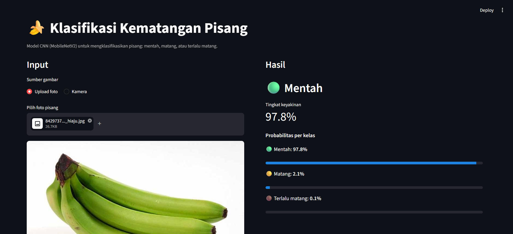
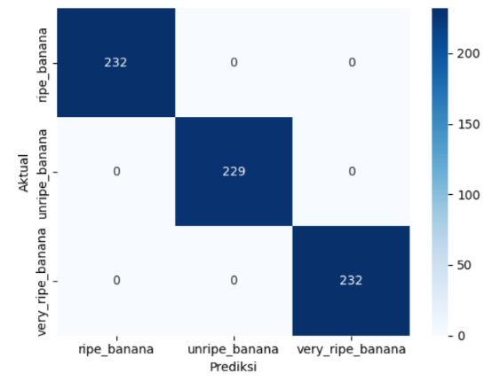

# 🍌 Klasifikasi Kematangan Pisang

Aplikasi klasifikasi tingkat kematangan pisang (mentah, matang, terlalu matang)
dari foto, menggunakan CNN dan transfer learning MobileNetV2, dengan antarmuka Streamlit.



## Latar belakang
Proyek tugas besar mata kuliah Pengolahan Citra Digital. Tujuannya membandingkan
CNN dari nol dengan transfer learning, serta menguji seberapa baik model
bekerja pada foto di luar dataset.

## Dataset
- Tiga kelas: `unripe_banana`, `ripe_banana`, `very_ripe_banana`
- 2.351 citra latih, 414 validasi, 693 uji (sebaran antar kelas seimbang)
- Sumber: (isi nama dan tautan dataset)
- Dataset tidak disertakan di repo ini.

## Metode
| | Model 1 | Model 2 |
|---|---|---|
| Arsitektur | CNN dari nol (4 blok Conv + BatchNorm) | MobileNetV2 pretrained ImageNet (frozen) |
| Input | 224×224 | 224×224 |
| Augmentasi | flip, rotasi, zoom | flip, rotasi, zoom, brightness, contrast |
| Optimizer | Adam (1e-3) | Adam (1e-3) |

## Hasil
| Pengujian | CNN dari nol | MobileNetV2 |
|---|---|---|
| Data uji dataset (693 citra) | 100% | 100% |
| Subset uji tanpa kembaran (83 citra) | 100% | (isi) |
| Foto sendiri (n = (isi)) | (isi) | (isi) |



## Temuan dan keterbatasan
- **Akurasi 100% di data uji tidak bisa dipercaya sepenuhnya.** Pengecekan
  kemiripan gambar menunjukkan 342 dari 693 citra uji punya foto yang sangat
  mirip di data latih (jarak hash ≤ 6), kemungkinan hasil augmentasi dari foto yang sama.
- CNN dari nol sempat salah memprediksi pisang kuning mulus sebagai
  "terlalu matang" dengan keyakinan 100%, sedangkan MobileNetV2 memprediksi
  dengan benar ("matang", 99,8%).
- Pelatihan CNN dari nol tidak stabil (val_loss melonjak di beberapa epoch),
  sedangkan MobileNetV2 stabil.
- Model mengklasifikasikan satu label per gambar, sehingga foto berisi beberapa
  tandan dengan tingkat kematangan berbeda tidak bisa ditangani.
- Dataset didominasi foto berlatar putih; kinerja pada latar lain perlu diuji lebih lanjut.

## Cara menjalankan
```bash
git clone https://github.com/ahmdspndi19/banana-ripeness-classification.git
cd banana-ripeness-classification
python -m venv venv
venv\Scripts\activate
pip install -r requirements.txt
streamlit run app.py
```

## Struktur proyek
```
├── app.py              # aplikasi Streamlit
├── notebooks/          # training dan evaluasi
├── models/             # model terlatih dan classes.json
├── assets/             # gambar untuk dokumentasi
└── requirements.txt
```

## Pengembangan lanjutan
- Fine-tuning MobileNetV2 dan penambahan foto sendiri ke data latih
- Deteksi objek (misalnya YOLO) agar bisa menangani banyak buah dalam satu foto

## Penulis
Ahmad Supandi · GitHub: [@ahmdspndi19](https://github.com/ahmdspndi19)